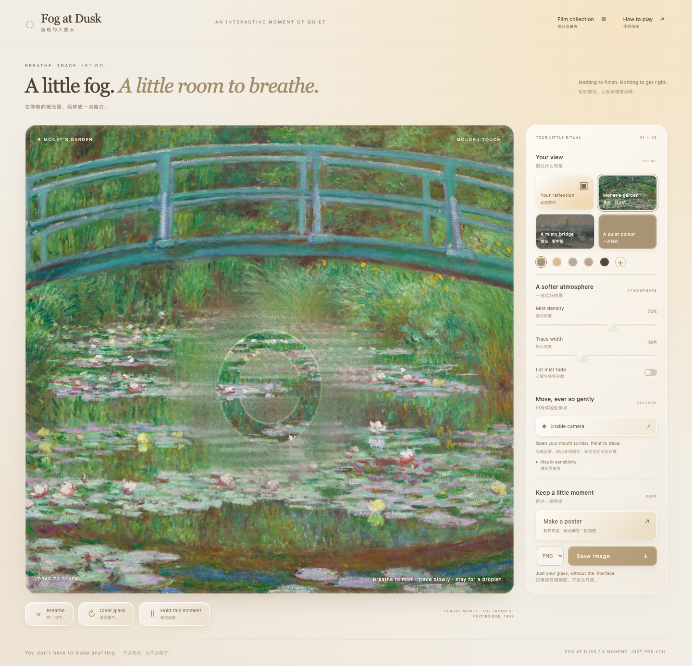

# Fog at Dusk · 傍晚的大雾天

A browser-based glass experience: an initially clear view, localized breath mist, fingertip traces and slowly falling droplets. Designed by Eating-Yuting with AI implementation assistance. Prepared for SD5913 Assignment 3. The project follows the teacher’s current brief: code that handles human interaction, presented as a web application and submitted as a repository.



## Play online / 在线试玩

**[Open Fog at Dusk →](https://eating-yuting.github.io/Fog-at-Dusk/)**

Use a recent desktop Chrome, press **Enable camera**, and allow camera access. The first visit downloads the bundled tracking models; give them time to load. You can also use the mouse without a camera. No installation or API key is needed.

Camera processing stays in your browser. Postcards are saved in this browser on this website; collections from a localhost address do not transfer automatically. Download PNG/JPG copies to keep them elsewhere.

中文：点击上方链接即可试玩；建议使用电脑 Chrome，允许摄像头后张嘴起雾、伸食指擦写。首次需等待模型加载，也可用鼠标。在线与本地收藏分开保存。

## Run locally / 本地打开

Requirements: Python 3.9+ and a recent desktop Google Chrome with WebGL. No Node.js, package installation or AI account is needed to play. Unzip the project, open its folder in VS Code, then open Terminal → New Terminal. From the project root:

```sh
python3 run.py
```

On Windows, use `py -3 run.py` if `python3` is unavailable. Keep the terminal open while playing. Do not double-click `dist/index.html`; the app needs a local web server.

Open http://127.0.0.1:8769 in a recent desktop Chrome. Use localhost or HTTPS for camera access. The application and its tracking models are included locally; it does not need a course API key, paid service, account or model-generation server. To stop the local server, press Ctrl+C in its terminal.

## Experience / 体验

- **Start clear.** The garden preview stays clear until you add mist. Enabling the camera replaces the background with a mirrored live image.
- **Breathe.** Open your mouth: mist appears near the corresponding mouth position. Close it to stop adding mist. A sensitivity control adjusts the opening threshold. Alternatively, hold Breathe, or hover over the glass and hold Space.
- **Trace.** Extend an index finger and move it in view. Bend it or move the hand out of view to lift. Mouse dragging and touch also draw directly from the user's trajectory. A cached feathered brush preserves the hand-drawn path, with small beads along damp edges and thin trickles. No handwriting recognition, automatic lettering or generated strokes are used.
- **Stay.** Hold a drawing position within a small tolerance for three seconds. One droplet forms and slides down; move to another position to repeat.
- **Keep.** Freeze the composition, select the live camera, a solid colour or one of two Monet paintings, then export the rendered glass to PNG or JPG. UI controls are excluded. The exported dimensions match the drawing surface, capped for browser performance; this is not a print-resolution exporter.
- **Make a poster.** Freeze the current glass into a warm-paper portrait layout, add a message up to 200 visible characters (emoji clusters count as one), and export a 1200 × 1800 PNG/JPG. The captured glass is fitted without cropping; adding pixels does not add camera detail. If there are too many manual line breaks to fit, the poster flows them into paragraphs.
- **Film collection.** Keep or export explicitly to store the postcard in this browser's IndexedDB. Reopen a film frame to edit or download it. Re-saving the same postcard updates it. Clearing site data, switching browser/profile, or changing localhost port will affect access; download copies for durable storage. This is an in-app collection, not an automatically created operating-system folder.
- **Clear.** Clear glass removes all mist, marks and droplets. Let mist fade controls slow natural dissipation.

中文：清晰玻璃开始；张嘴在嘴部镜像位置起雾；伸食指擦写、弯曲抬笔；同处停留三秒滴水；可定格、换背景并保存。不开镜头也能用鼠标或触屏。

## User direction and implementation choices

**User direction:** a calming experience, mouth- and fingertip-tracked interaction, handmade marks, three-second droplets, camera / solid / Monet backgrounds, local PNG/JPG output, frosted controls, English primary with smaller Chinese descriptions, and warm streetlamp colours. The user clarified that the initial glass must be clear and mist must appear only locally.

**Implementation choices:** MediaPipe Face and Hand Landmarker, entirely on the device; a WebGL glass renderer driven by a 2D moisture mask; index extension as a virtual contact gesture; camera and landmark positions share the same mirrored cover transform; worker inference avoids blocking drawing. The display follows requestAnimationFrame rather than a fixed 30 Hz cap; hand inference is requested at up to 20 Hz when the worker is free, with a short time-based interpolation between results. Brief tracking loss lifts the drawing point; stale targets expire after 250 ms. Actual rates depend on the device. The scene uses a restrained amber light tint and frosted controls. Monet is a preview until camera permission is granted.

**Not yet established:** relief or stress reduction is a design intention, not a measured clinical or user-study result. On 2026-10-09, the designer reported that four real-camera tasks worked normally: localized mouth mist, tracing a circle, bending the finger to stop, and holding to release a droplet. This is a single-person functional check, not a measured usability study. This prototype uses mouth opening as a proxy; a normal camera does not measure real exhalation, humidity, temperature, or physical finger-to-screen contact. Three seconds is a designed feedback threshold.

## Privacy and lifecycle

Camera permission is requested only after clicking Enable camera. No microphone is requested. Frames are processed locally in a worker; no camera frames, landmarks or exported images are sent to a server. No analytics, external fonts, course API keys or cookies are included. Only an explicit Keep / Export poster action stores a captured still and its message in this browser; it does not store video or tracking landmarks. Previewing a poster alone does not persist it. Turn camera off stops all stream tracks and terminates the worker. Export saves locally only when requested. Anyone whom you explicitly give the exported image can see whatever background it contains.

## Physical reference and artistic simplification

Condensation forms when a surface is below the dew point of adjacent air [1]. The visual treatment uses localized mist, fine irregular refraction, transparent wiped trails and rounded drops. It is a designed visual approximation: droplet optics, airflow, surface tension, temperature and wetting are not numerically simulated.

Face and hand landmarks are supported by the MediaPipe browser APIs [2–3]. Their output provides the positions used by this interaction, not proof of actual breathing or contact.

## Artwork provenance

Both artwork pages explicitly describe their media as public domain [4–5]. Local images came from the museum's download endpoints; source URLs and titles are retained in `dist/assets/artworks.json`.

- Claude Monet, *The Japanese Footbridge*, 1899, National Gallery of Art.
- Claude Monet, *Waterloo Bridge, Gray Day*, 1903, National Gallery of Art.

## Checks and remaining limits

`check-poster.mjs` additionally checks wet-edge beads, poster freezing, the 200-character limit, downloads, collection persistence and mobile layout. `check.mjs` contains checks for cover-coordinate mirroring, the three-second threshold, initial transparency, localized fog, clearing by strokes, droplet release, pause, scene switching, PNG/JPG export, local tracking initialization, camera shutdown and narrow-screen layout. Browser tests use synthetic camera input; they do not access the user's actual camera. The designer has confirmed the four core real-camera actions in a hands-on check. Quantitative latency, other people, low light and other browsers have not been validated. In low light or during occlusion, use mouse/touch or improve illumination.

The app is buildless. This repository contains its source and assets. GitHub Pages publishes only `dist` through `.github/workflows/pages.yml`; pushing changes to `dist` on `main` redeploys the website. Camera permission may be unavailable inside some embedded previews; open the website directly in Chrome in that case.

## Project guide / 文件导航

- [INTERACTION.md](INTERACTION.md): the input → response → feedback sequence, demo walkthrough and code map.
- [PROCESS.md](PROCESS.md): design decisions, iteration and AI assistance disclosure.
- [TESTING.md](TESTING.md): automatic checks, the designer’s real-camera report, and remaining limits.
- [SOURCES.md](SOURCES.md): artwork, dependencies, model sources and licences.
- [SUBMISSION-CHECKLIST.md](SUBMISSION-CHECKLIST.md): confirmed requirements and remaining hand-in questions.

## Troubleshooting / 常见情况

| Situation | What to do |
|---|---|
| Port 8769 already in use | Keep using the existing app, or run `python3 run.py --port 8770`. A new port has a separate local collection. |
| Camera permission declined | Re-enable the camera in the browser’s site permissions, then press Enable camera; mouse/touch still works. |
| Tracking does not start | Wait for models to load locally, use desktop Chrome, improve front lighting, and keep one hand and face visible. |
| Canvas is clear and strokes seem invisible | Add local mist first by holding Breathe / Space or opening your mouth. |
| Drawing is paused | Press Let it flow after closing the poster or collection. |
| A saved postcard is missing | Return to the same browser profile and URL/port; download images for storage outside the browser. |

## Reproduce the automated checks

Only developers running checks need Node.js 20+ and Playwright. Install the pinned development dependency with `npm install`, start `python3 run.py` in one terminal, then run `npm test` in another. The checks use the installed Google Chrome, an isolated browser profile and a synthetic camera. They create test images; these are ignored by Git. `TEST_URL` can point the checks to a different local port. These are project checks, not the course’s official A3 checker.

## References

[1] MET OFFICE. Dew[EB/OL]. [2026-10-09]. https://weather.metoffice.gov.uk/learn-about/weather/types-of-weather/temperature/dew

[2] GOOGLE. Face landmark detection guide for Web[EB/OL]. [2026-10-09]. https://developers.google.com/edge/mediapipe/solutions/vision/face_landmarker/web_js

[3] GOOGLE. Hand landmarks detection guide for Web[EB/OL]. [2026-10-09]. https://developers.google.com/edge/mediapipe/solutions/vision/hand_landmarker/web_js

[4] NATIONAL GALLERY OF ART. The Japanese Footbridge[EB/OL]. [2026-10-09]. https://www.nga.gov/artworks/74796-japanese-footbridge

[5] NATIONAL GALLERY OF ART. Waterloo Bridge, Gray Day[EB/OL]. [2026-10-09]. https://www.nga.gov/artworks/46658-waterloo-bridge-gray-day
